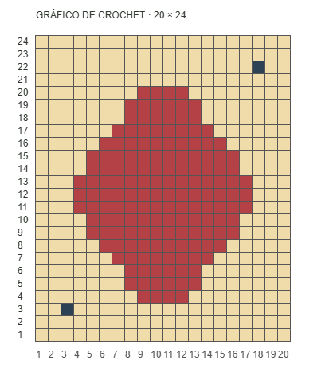
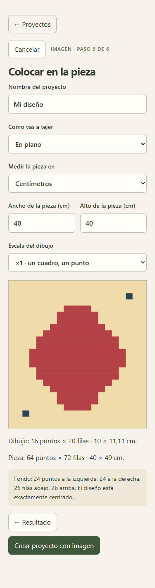
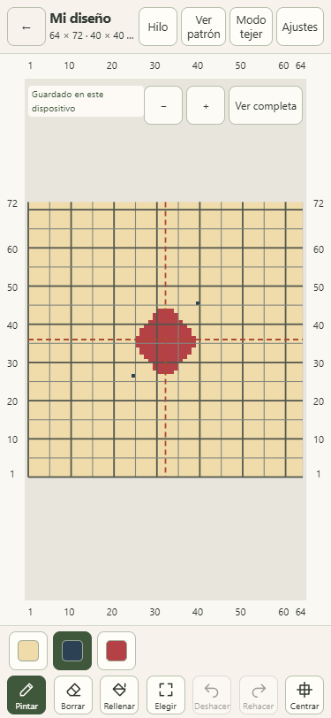

# Validación del encargo 5 — Importar una imagen

Fecha: 11 de octubre de 2026. Rama: `encargo-05-importar-imagen`, creada desde `master` actualizado a `8e25651`.

Vista previa comprobada: [Cloudflare Pages de la rama](https://encargo-05-importar-imagen.punto-a-punto.pages.dev/).

## Resultado por criterio

| Criterio                                  | Resultado observado                                                                                                                                                            |
| ----------------------------------------- | ------------------------------------------------------------------------------------------------------------------------------------------------------------------------------ |
| Elegir, recortar, girar y revisar cuadros | Asistente local con recorte por esquinas o medidas, rotación de 90° y rejilla que cambia al corregir columnas o filas.                                                         |
| Recuperar pixel art                       | Las pruebas generadas recuperan los 480 cuadros de 20 × 24, incluidos líneas de 1 y 2 px, ruido similar a JPEG, márgenes blancos y cuadros de 10,24 px con distintos desfases. |
| Pocos bordes                              | La prueba con una zona grande de un color recupera 20 × 24; no duplica el periodo.                                                                                             |
| Colores y transparencia                   | Límite editable de 2 a 12, vista previa, fusión, nombres y selección de fondo. Alpha menor de 128 se trata como fondo y se conserva al escalar.                                |
| Fotos y degradados                        | Aviso de que no hay cuadros y habrá que retocar; ancho manual y filas según la proporción física de la muestra. 400 × 300, 60 columnas, punto de 0,625 × 0,556 cm: 51 filas.   |
| Tamaño, escala y centrado                 | Vista previa física, puntos y centímetros; márgenes del mismo `centerDesign` que usa el editor. ×2 replica cada cuadro en un bloque de 2 × 2.                                  |
| Dibujo que no cabe                        | No se coloca: ofrece agrandar al mínimo, con medida en cm, o reducir. Las escalas no enteras muestran un aviso antes de aceptar.                                               |
| Paleta combinada mayor de 12              | Se bloquea la colocación y se pide fusionar con colores existentes. Probado con una paleta inicial de 12 que llegaría a 14.                                                    |
| Proyecto existente y deshacer             | Importación ×2 sobre un proyecto abierto. Un clic en «Deshacer» recuperó todas las celdas, dimensiones y paleta anteriores.                                                    |
| Acciones visibles                         | «Hilo», «Ver patrón» y «Modo tejer» en la misma barra superior de 44 px; la cuadrícula conserva su espacio.                                                                    |
| Puntos por color                          | Panel de hilo, pantalla de patrón, texto y PDF incluyen los puntos junto a los metros. Los recuentos del proyecto de aceptación sumaron 4608 = 64 × 72.                        |
| Móvil                                     | Recorrido a 375 × 812: sin desbordamiento horizontal, sin controles visibles menores de 44 × 44 px y sin errores de consola.                                                   |
| Servidor y offline                        | Recorridos locales y en Cloudflare, con conexión y después de recargar sin conexión. El worker de imágenes se carga desde la caché de la PWA.                                  |

## Captura equivalente a un patrón de crochet

Esta imagen se generó para la validación; no procede de terceros. Contiene 20 × 24 cuadros de 16 px, líneas de cuadrícula, números en los bordes y tres colores. El archivo completo mide 408 × 472 px.

Para repetir el recorrido en una ventana de 375 × 812:

1. «Crear proyecto → Desde una imagen», eligiendo la imagen anterior.
2. Recorte: desde la izquierda **44 px**, desde arriba **44 px**, ancho **320 px**, alto **384 px**. La rejilla detectada debe mostrar **20 × 24**; no se corrigieron esos números.
3. Leer colores: se propusieron **3**, sin cambiar la paleta ni las celdas.
4. Usar la muestra aproximada de aguja de 4 mm, pieza **40 × 40 cm**, escala **×1**.
5. Antes de aceptar: pieza **64 × 72**, dibujo ocupado **16 × 20** (10 × 11,11 cm), fondo **24 puntos a izquierda y derecha**, **26 filas abajo y arriba**.
6. Crear el proyecto, exportar el JSON y contrastar cada celda con la imagen recortada y su desplazamiento de centrado.

Se compararon las **4608 celdas** de la pieza, incluidos todos sus márgenes. **Retoques manuales: 0 cuadros.** Se eligió el recorte; no se corrigió el dibujo.

| Color           | Puntos tejidos |
| --------------- | -------------: |
| Fondo `#f0dcaa` |           4448 |
| Azul `#2d4155`  |              2 |
| Rojo `#b44146`  |            158 |
| Total           |       **4608** |

## Imagen grande y respuesta de la interfaz

Una imagen sintética de **4000 × 4000** con 100 × 100 cuadros se redujo en el worker a **1600 × 1600**, y recuperó sus **100 × 100** cuadros y tres colores. Se observaron mensajes al abrir, reducir, detectar bordes, muestrear centros y unir tonos.

En la versión compilada local, el mayor intervalo entre fotogramas durante apertura, detección y lectura de colores fue **26,3 ms**; en Cloudflare, **29,2 ms**. Ambas pruebas terminaron sin errores de consola. Se midió con Chromium de escritorio en un contexto aislado que emulaba la ventana móvil; no es una medición de rendimiento en un teléfono físico.

## Otras comprobaciones del recorrido

En local y Cloudflare se ejercitaron: archivo inválido seguido de recuperación, cuatro giros de 90°, corrección manual de columnas con cambio de la rejilla, límite de colores con vista previa, renombrar y fusionar, conflicto de paleta de 14 colores y resolución hasta 12, cancelar sin cambiar el proyecto, pieza demasiado pequeña, reducción y aviso de escala fraccionaria.

También se importó un degradado suave de 400 × 300 desde archivos: se clasificó como no pixel art, generó 60 × 51 puntos con la muestra de 4 mm y creó un proyecto centrado. No se envió la imagen al servidor: las solicitudes observadas fueron lecturas de archivos de la aplicación en su propio origen; el recorrido completo también pasó con la red desactivada.

## Comandos

| Comando                | Resultado                                                               |
| ---------------------- | ----------------------------------------------------------------------- |
| `npm run typecheck`    | Código de salida 0; TypeScript estricto sin errores.                    |
| `npm run lint`         | Código de salida 0; sin errores ni advertencias.                        |
| `npm run format:check` | Código de salida 0; todos los archivos comprobados siguen Prettier.     |
| `npm test`             | Código de salida 0; **200 pruebas en 21 archivos**.                     |
| `npm run build`        | Código de salida 0; build de producción y worker de imágenes incluidos. |

Las pruebas puras de importación y colocación están en `src/core/imageImport.test.ts` y `src/core/imagePlacement.test.ts`. Generan sus datos RGBA en la propia prueba y cubren las entradas inválidas, transparencia, foto, escalado, centrado y paleta. No necesitan imágenes descargadas ni APIs del navegador.

## Referencias estudiadas y decisiones

- [proper-pixel-art](https://github.com/KennethJAllen/proper-pixel-art): proyecciones, periodo, uniformidad de cuadros, malla completada, color dominante y unión de tonos próximos.
- [unfake.js](https://github.com/jenissimo/unfake.js): periodos fraccionarios y fases independientes. Las proyecciones, candidatos de autocorrelación y comprobación de uniformidad superaron las pruebas, por lo que no fue necesario añadir otro detector por tramos.
- [Stitch Fiddle: importar una imagen](https://www.stitchfiddle.com/en/help/1pej-wc93j/import-picture): orden del asistente, rotación y corrección de tamaño y colores.
- [crochet-engine](https://github.com/dengyu123456/crochet-engine): compensación por ancho del punto y alto de fila, aplicada únicamente a fotos, y recuentos por color.

Se reimplementaron las ideas en TypeScript; no se copió código de las referencias ni se añadieron dependencias. La detección supone cuadros aproximadamente cuadrados; cuando no puede inferirlos con confianza, la rejilla sigue siendo editable y se ofrece el camino de foto. Las escalas enteras conservan el pixel art; la compensación de muestra se aplica solo a fotos.

Para acotar memoria se eligió un máximo de 1600 px por lado durante el análisis y 64 MB por archivo de entrada. El proyecto guarda únicamente celdas y paleta. Al importar en un proyecto existente, el fondo de la imagen deja visible el dibujo previo; los puntos de otros colores se colocan encima. Colores de igual hexadecimal reutilizan la paleta; los demás se añaden o se fusionan explícitamente. «Ajustar al ancho» limita también el lado largo por la altura disponible y el margen, para que no se corte.

No se añadieron proyectos de ejemplo ni se hizo un rediseño general. `docs/SPEC.md` y `docs/encargos/05-importar-imagen.md` conservaron exactamente sus cambios locales anteriores y permanecieron sin confirmar; no forman parte de los commits del encargo.
