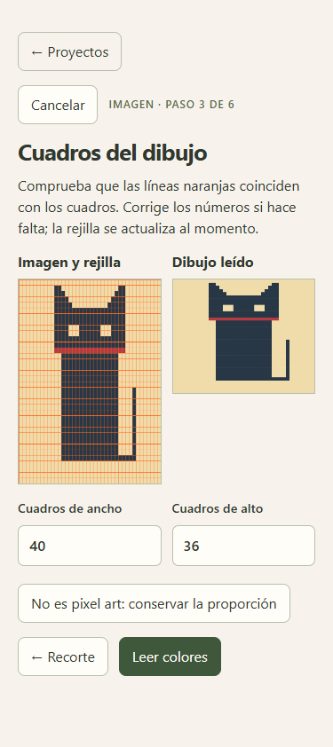
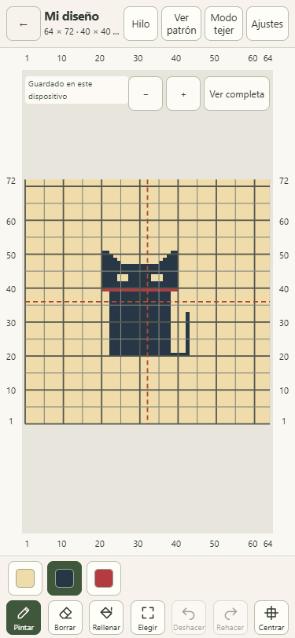
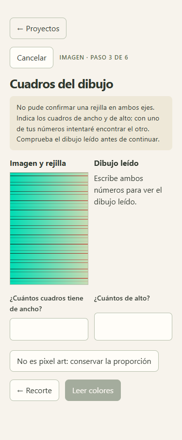

# Validación del encargo 5b — Cuadros rectangulares y detección dudosa

Fecha: 12 de octubre de 2026. Corrección en la rama `encargo-05-importar-imagen`, dentro del [PR 2 existente](https://github.com/jrod-md/punto-a-punto/pull/2).

Vista previa comprobada: [Cloudflare Pages de la rama](https://encargo-05-importar-imagen.punto-a-punto.pages.dev/).

## Cambios por criterio

| Petición                        | Comportamiento y evidencia                                                                                                                                                                                                                                                                   |
| ------------------------------- | -------------------------------------------------------------------------------------------------------------------------------------------------------------------------------------------------------------------------------------------------------------------------------------------- |
| Cuadros rectangulares           | Se admiten periodos distintos por eje, incluidos 10 × 16, 16 × 10, 10 × 25 y 25 × 10 px. La malla 40 × 36 se recupera sin cambios de celda en los dibujos limpios generados.                                                                                                                 |
| Reconocer incertidumbre         | Cada periodo debe tener evidencia en su propio perfil de bordes antes y después del ajuste de fase. Una imagen con un eje periódico y otro irregular devuelve `null` y la interfaz deja ambos campos vacíos, con las preguntas de ancho y alto. No cambia automáticamente al camino de foto. |
| Corregir con una pista          | Confirmar 40 columnas en una imagen cuya detección completa falló vuelve a buscar el eje vertical y obtiene 36 filas. También se prueba la pista inversa. Las cifras introducidas manualmente no se borran si el otro eje sigue siendo dudoso.                                               |
| Imágenes pequeñas               | Si un cuadro mide menos de unos 6 px, aparece el aviso de usar la imagen original en lugar de una captura del chat. La lectura sigue disponible.                                                                                                                                             |
| Comprobación antes de continuar | En el paso de cuadros, la imagen con la rejilla y el dibujo leído se muestran juntos. La lectura se actualiza en el worker al cambiar los números; no añade ningún paso ni pantalla.                                                                                                         |

La selección puntúa la uniformidad y el desfase de los bordes, para evitar elegir un periodo doble o una subdivisión sin respaldo. La comprobación de periodicidad usa la coherencia de fase de cada proyección, normalizada por su energía. Los candidatos del otro eje sirven únicamente como pistas de armónicos cuando faltan bordes: cada eje debe confirmarlos con su propia señal. La tolerancia de proporción contempla el redondeo de capturas fraccionarias alrededor del límite 2,5.

Una imagen claramente suave sigue entrando al camino de foto. En los casos dudosos, ese camino se activa por elección de la usuaria. Se conserva la lectura literal de pixel art nativo pequeño, pero no se usa para inventar una malla cuando solo se detecta periodicidad en uno de los ejes.

## Pruebas puras

`src/core/imageRectangles.test.ts` genera todos sus datos RGBA. No lee imágenes externas:

- Dibujo 40 × 36 con cuadros de 10 × 16 y 16 × 10 px, líneas de 1 px: idéntico.
- Límites de proporción 10 × 25 y 25 × 10 px: idéntico.
- Dibujo generado a 20 × 32 px, reducido por promedio exacto de área a 204 × 295 px (aproximadamente 5,1 × 8,2 px por cuadro), con marcas numéricas generadas fuera del recorte: recupera 40 × 36 y cumple el máximo de 3 % de diferencias.
- La misma imagen pequeña ampliada ×4 con interpolación bilineal: recupera 40 × 36 y cumple el mismo máximo de diferencias. No propone la malla falsa de cuadros de 5 px.
- Periodicidad en un solo eje, incluido un caso pequeño de pocos colores: devuelve `null` y clasifica como dudosa.
- Corrección de columnas a 40 después del fallo: calcula 36 filas. La búsqueda del eje pendiente no exige que el eje confirmado vuelva a superar la detección automática.
- Un degradado suave conserva la clasificación de foto; las pistas con números inválidos se rechazan.

Las pruebas anteriores de cuadros cuadrados, periodos fraccionarios, ruido, márgenes y zonas grandes de un color siguen pasando.

## Recorrido móvil en local y Cloudflare

Se generó una captura de un gato geométrico para esta prueba, con cuadrícula rectangular y números en los bordes. El dibujo es propio de la validación; no es ninguna de las capturas de terceros mencionadas en el encargo.

La [captura sintética de origen](assets/importar-05b-origen.png) está incluida para repetir el recorrido.

Recorrido a **375 × 812**: crear proyecto desde imagen, recortar desde **44 px a la izquierda y 44 px arriba**, con **400 × 576 px**, leer colores y crear una pieza **40 × 40 cm**, muestra aproximada de aguja de 4 mm, escala ×1.

Resultado: **40 × 36 cuadros detectados sin corregir ninguno de los dos números**, tres colores y proyecto **64 × 72**. Se exportó el JSON y se contrastaron sus **4608 celdas** con el dibujo y su desplazamiento de centrado. **Retoques manuales: 0 cuadros.**

Se probaron también la captura pequeña de 204 × 295 y su ampliación suave a 816 × 1180: ambas dieron **40 × 36**, y la pequeña mostró el aviso de resolución. En otra imagen generada con un eje claro y el otro sin periodicidad, la app preguntó los dos números y bloqueó «Leer colores» hasta disponer de ambos. Al escribir **40** columnas, calculó **36** filas y mostró la comprobación leída.

Los mismos recorridos pasaron en la versión compilada local y en Cloudflare, incluida la recarga con la red desactivada y el uso del worker desde la caché. En las etapas de rejilla, resultado, imagen pequeña, ampliación, incertidumbre y corrección guiada no hubo desbordamiento horizontal ni controles visibles menores de **44 × 44 px**. Sin errores de consola y sin solicitudes que enviaran imágenes o datos del proyecto. El recorrido cuadrado anterior, incluido deshacer una importación en un paso, se comprobó de nuevo.

Las comprobaciones de navegador se ejecutaron en Chromium de escritorio con ventana móvil emulada. Las dos capturas reales de terceros no estaban disponibles en el repositorio y no se incorporaron ni se subieron. La aceptación de este encargo se comprobó con las imágenes generadas que pide.

## Comandos y alcance

| Comando                | Resultado                                            |
| ---------------------- | ---------------------------------------------------- |
| `npm run typecheck`    | Salida 0; sin errores.                               |
| `npm run lint`         | Salida 0; sin errores ni advertencias.               |
| `npm run format:check` | Salida 0; formato correcto.                          |
| `npm test`             | Salida 0; **210 pruebas en 22 archivos**.            |
| `npm run build`        | Salida 0; aplicación y worker incluidos en el build. |

No se añadieron dependencias, funciones de producto, pasos del asistente ni cambios fuera de los cinco puntos del encargo. `AGENTS.md`, `docs/SPEC.md` y los encargos se conservaron sin modificaciones. No se abrió otro PR, no se fusionó el PR 2 y no se hizo push a `master`.
