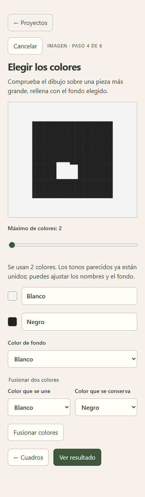
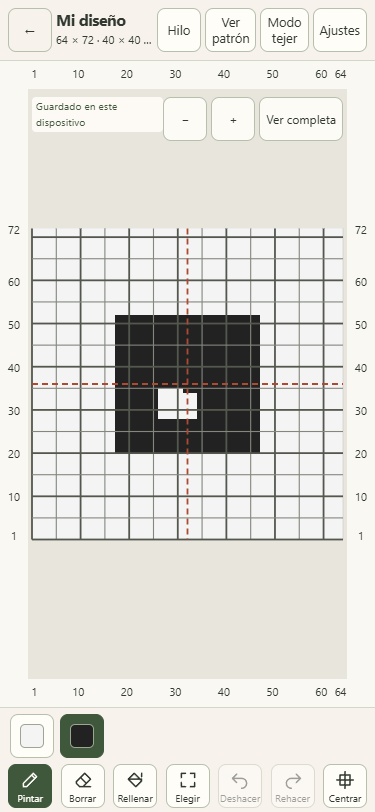
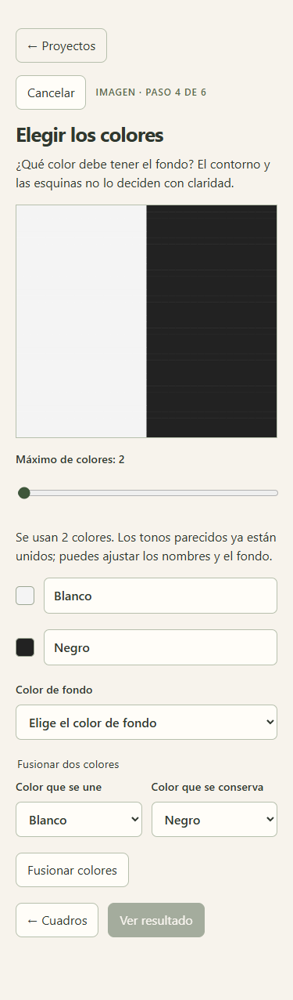

# Validación del encargo 5c — Fondo de la imagen importada

Fecha: 12 de octubre de 2026. Corrección en la rama `encargo-05-importar-imagen`, dentro del [PR 2 existente](https://github.com/jrod-md/punto-a-punto/pull/2).

Vista previa comprobada: [Cloudflare Pages de la rama](https://encargo-05-importar-imagen.punto-a-punto.pages.dev/).

## Cambios por criterio

| Petición            | Resultado                                                                                                                                                                                                                             |
| ------------------- | ------------------------------------------------------------------------------------------------------------------------------------------------------------------------------------------------------------------------------------- |
| Fondo por el borde  | Se cuentan las celdas del contorno una sola vez. Una mayoría clara propone el fondo; en caso contrario se consultan las esquinas. Si tampoco deciden, no se propone ningún índice y se pide elegir.                                   |
| Que el error se vea | El paso de colores muestra el dibujo centrado sobre una pieza mayor, rellena con el fondo seleccionado. Cambiar el fondo actualiza esa vista. Cuando aún no hay elección, muestra la imagen y la pregunta, y bloquea «Ver resultado». |
| Medidas sin fondo   | Tanto el resultado como la colocación usan `designBounds`; el centrado sigue usando `centerDesign`. Una figura de 30 × 32 dentro de 36 × 36 informa 30 × 32, no el tamaño del recorte.                                                |
| Nombres de color    | Se proponen Negro, Blanco, Gris, Rojo, Naranja, Amarillo, Verde, Azul, Morado, Rosa, Marrón o Beige. Los tonos repetidos se distinguen con claro y oscuro; los nombres siguen siendo editables.                                       |
| Recorte sin jerga   | Arrastrar las esquinas es el control principal. Los cuatro campos en píxeles quedan en «Ajuste fino», plegado al entrar. El recorrido de aceptación recortó con las esquinas, sin abrir esa sección.                                  |

## Pruebas puras

`src/core/imageBackground.test.ts` genera cuadrículas y muestras RGBA:

- Figura oscura con **907 de 1296 celdas** (aproximadamente 70 %) y contorno claro: se propone el claro, aunque el oscuro es más frecuente en toda la imagen.
- Figura clara con contorno oscuro: se propone el oscuro.
- Dibujo con dos colores que toca los cuatro bordes y empata tanto en el contorno como en las esquinas: fondo `null`, sin colocación posible hasta elegirlo.
- Contorno indeciso y tres esquinas del mismo color: se usa ese color. Las esquinas no se cuentan dos veces; se prueban también una sola fila, una sola columna y una celda.
- Figura **30 × 32** en recorte **36 × 36**, colocada en pieza **64 × 72**: márgenes **17 / 17 / 20 / 20** y el mismo número de puntos de figura.
- Vista previa mayor con fondo correcto o incorrecto, dibujo vacío y entradas inválidas.
- `#222222`, `#f4f4f4`, `#b44146` y `#2d4155`: **Negro, Blanco, Rojo y Azul**. También se prueban las otras familias y dos rojos de distinta intensidad.

Las pruebas anteriores de importación, rectángulos, colocación, transparencia y deshacer siguen pasando.

## Recorrido a 375 × 812

Se generó una [captura propia de origen](assets/importar-05c-origen.png) con **36 × 36** cuadros de **10 × 16 px**, líneas y números. Contiene una figura negra grande sobre blanco; sus huecos interiores dejan **907 celdas negras**, dentro de un rectángulo envolvente de **30 × 32**. No se usaron imágenes de terceros.

Se eligió el archivo y se recortó arrastrando las dos esquinas para dejar el área de **360 × 576 px**, desde **44 px a la izquierda y 44 px arriba**. «Ajuste fino» permaneció cerrado. La app detectó 36 × 36, propuso dos colores llamados **Blanco** y **Negro** y eligió **Blanco** como fondo.

Sin cambiar los números, los colores, el fondo, la escala, la muestra ni las medidas iniciales de **40 × 40 cm**, el resultado informó:

- Dibujo: **30 puntos × 32 filas**, **18,75 × 17,78 cm**.
- Pieza: **64 × 72**, **40 × 40 cm**.
- Fondo: **17 puntos a izquierda y derecha**, **20 filas abajo y arriba**, exactamente centrado.

Se exportó el JSON y se contrastaron **todas las 4608 celdas**: **3701 blancas y 907 negras**, con fondo `#f4f4f4` y figura `#222222` en sus posiciones esperadas. **Cambios manuales de opciones: 0. Retoques de celdas: 0.** El recorte fue la única selección geométrica del recorrido.

También se comprobó elegir Negro en el paso de colores: el exterior de la vista previa cambió inmediatamente a negro, dejando visible el rectángulo blanco del recorte. La imagen inversa propuso Negro por defecto. La imagen empatada dejó el selector sin elegir, pidió el fondo y mantuvo «Ver resultado» desactivado hasta responder.

Los mismos casos pasaron en el build local y Cloudflare, con conexión y después de recargar sin conexión. Sin errores de consola, solicitudes que envíen imágenes o datos, desbordamiento horizontal ni controles visibles menores de **44 × 44 px**, incluida la sección de ajuste fino. Se repitió el recorrido rectangular y la corrección guiada de 5b. El navegador fue Chromium de escritorio con ventana móvil emulada; no se usó un teléfono físico.

## Comandos y decisiones

| Comando                | Resultado                                 |
| ---------------------- | ----------------------------------------- |
| `npm run typecheck`    | Salida 0; sin errores.                    |
| `npm run lint`         | Salida 0; sin errores ni advertencias.    |
| `npm run format:check` | Salida 0; formato correcto.               |
| `npm test`             | Salida 0; **217 pruebas en 23 archivos**. |
| `npm run build`        | Salida 0; aplicación y worker incluidos.  |

Como umbral de claridad se eligió **más del 50 %** del contorno y, si hace falta, de las esquinas distintas. Un empate nunca elige el color por orden de paleta ni por su abundancia global. La transparencia conserva su significado de fondo conocido, según el encargo 5. El fondo desconocido se representa como `null` y la lógica pura también impide colocarlo antes de elegir.

Los nombres se obtienen de familias de tono e intensidad RGB, sin dependencia ni servicio externo. La vista previa mayor reutiliza el mismo centrado y rectángulo envolvente del editor. No se añadieron pasos, pantallas ni cambios fuera de los cinco puntos de 5c. AGENTS, SPEC y los encargos permanecieron sin modificaciones. No se abrió otro PR, no se fusionó el PR 2 y no se hizo push a `master`.
