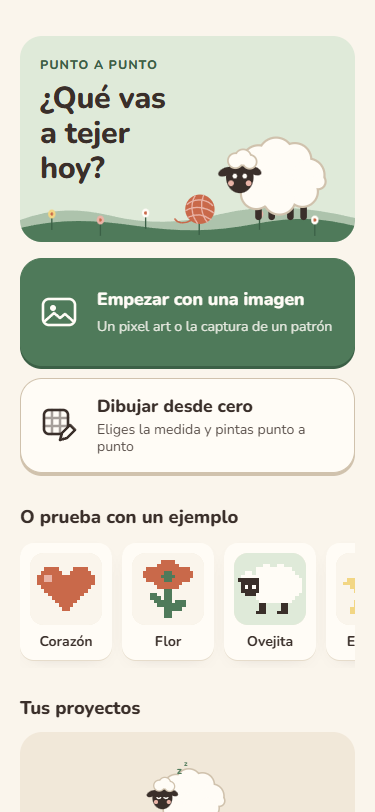
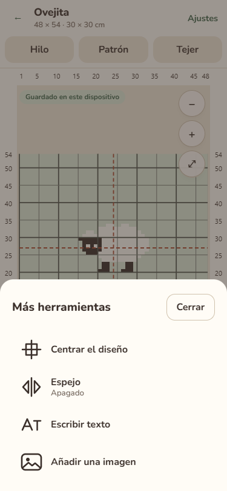
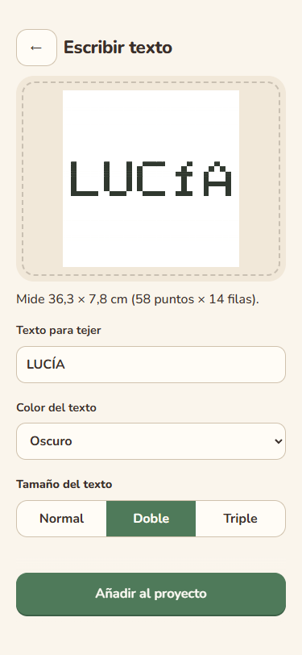
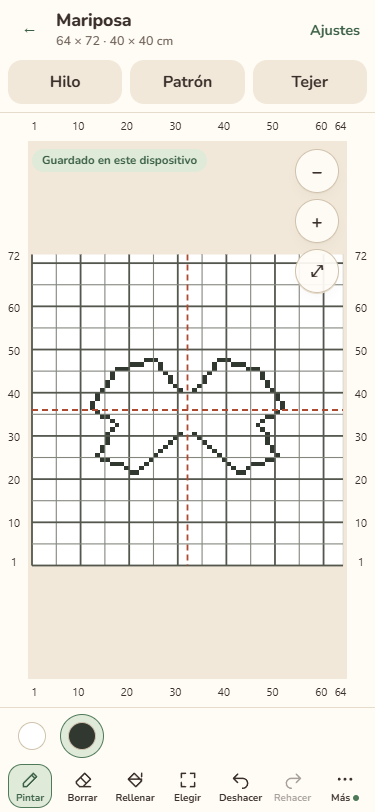

# Validación del encargo 6 — Ejemplos, texto y espejo

Fecha: 12 de octubre de 2026. Rama: `encargo-06-ejemplos-texto-espejo`, creada desde `master` actualizado.

Vista previa comprobada: [Cloudflare Pages de la rama](https://encargo-06-ejemplos-texto-es.punto-a-punto.pages.dev/). Cloudflare publica este alias acortado; la rama Git conserva el nombre completo.

## Cambios por criterio

| Parte          | Resultado                                                                                                                                                                                                                                                                                                                                                                                                                        |
| -------------- | -------------------------------------------------------------------------------------------------------------------------------------------------------------------------------------------------------------------------------------------------------------------------------------------------------------------------------------------------------------------------------------------------------------------------------- |
| 0 — Guía local | `DESIGN.md` deja de estar versionado y permanece en la carpeta local, ignorado junto con `AGENTS.md`. El encargo sin confirmar se conserva sin modificar ni incluir en los commits.                                                                                                                                                                                                                                              |
| A — Más        | Barra en el orden Pintar, Borrar, Rellenar, Elegir, Deshacer, Rehacer, Más. La hoja inferior contiene Centrar el diseño, Espejo con su estado, Escribir texto y Añadir una imagen. Se cierra al elegir, al tocar fuera y con Escape. Los iconos se dibujan en `Art.tsx` o reutilizan su icono de imagen. Importar imagen sale de Ajustes.                                                                                        |
| B — Texto      | Fuente original de 5 × 7 en el núcleo, con todas las letras, acentos, números y signos pedidos. Una sola vista previa sobre la pieza, color de la paleta, tamaños Normal/Doble/Triple y medidas en centímetros, puntos y filas. Si no cabe, se ofrecen las alternativas que sí caben. Al aceptar queda centrado y seleccionado con Elegir; añadirlo es un paso de Deshacer. Los caracteres desconocidos se omiten y se enumeran. |
| C — Espejo     | Pintar y Borrar reflejan también su vista previa durante el trazo. Cada trazo reflejado ocupa un paso de Deshacer. Rellenar no se refleja. Eje vertical visible y marca en Más; la columna central impar no se duplica. Estado de sesión, conservado al visitar el patrón y apagado al cerrar el proyecto, sin guardarlo en los datos.                                                                                           |
| D — Ejemplos   | Corazón, Flor, Ovejita y Estrella originales, de 20 × 20, con dos o tres colores y contorno de fondo completo. Miniaturas con `ProjectThumb` debajo de las dos formas de empezar, desplazables horizontalmente. Cada una crea una pieza de 30 × 30 cm con muestra de 4 mm y dibujo centrado. La fila se oculta al alcanzar tres proyectos.                                                                                       |
| E — Descargas  | PDF y PNG descargados de una pieza con texto, otra creada desde una imagen y una tercera que combina ambos. Se abren, mantienen los nombres de la paleta y coinciden con las celdas mostradas en el editor. No hubo que cambiar los exportadores.                                                                                                                                                                                |

## Comandos

| Comando                | Resultado                                                             |
| ---------------------- | --------------------------------------------------------------------- |
| `npm run typecheck`    | Salida 0; sin errores.                                                |
| `npm run lint`         | Salida 0; sin errores ni advertencias.                                |
| `npm run format:check` | Salida 0; formato de Prettier correcto.                               |
| `npm test`             | Salida 0; **231 pruebas en 26 archivos**, incluidas 14 nuevas.        |
| `npm run build`        | Salida 0; aplicación, worker de imágenes y service worker compilados. |

Las pruebas nuevas comprueban todos los glifos de 5 × 7, «ANA» de 17 × 7 con separación de un punto, bloques exactos de 2 × 2 y 3 × 3, acentos compuestos, omisión de caracteres desconocidos, texto vacío, color de fondo, ancho y alto insuficientes, centrado y restauración en un paso. Para el espejo incluyen columna 3 → 18 en una pieza de 20, columna central 11 única en una pieza de 21, trazos duplicados, borrado, deshacer y coordenadas inválidas. Los cuatro ejemplos se validan por dimensiones, paleta, contorno, número de puntos pintados y centrado.

## Recorridos comprobados

En desarrollo local, compilación de producción local y Cloudflare, con Chromium aislado a **375 × 812** y **1280 px de ancho**:

- Ovejita abre el editor con pieza de **48 × 54**, equivalente a **30 × 30 cm**. Su dibujo ocupa las columnas 16–33 y filas 21–34, contando desde 1, centrado con la fórmula de la especificación.
- La barra contiene los siete botones en su orden y no tiene desplazamiento ni recortes. Más muestra cuatro acciones; se comprobaron cierre con Escape, toque exterior y elección.
- **LUCÍA en doble** ocupa **58 × 14**, equivalente a **36,3 × 7,8 cm** en la muestra de 4 mm. En una pieza de 40 cm se acepta, se mueve con Elegir y se deshace hasta recuperar exactamente las celdas previas. En la pieza de 30 cm se impide añadirlo en una línea y se ofrecen tamaño normal o dos líneas; la opción en dos líneas se acepta y se deshace correctamente. Un emoji no compatible se omite con aviso.
- Un trazo continuo de media mariposa genera **108 puntos pintados** simétricos. Todas las parejas de columnas se compararon. Deshacer restaura la pieza vacía en un paso; Borrar elimina las dos posiciones reflejadas. Rellenar un lado de una pieza dividida deja el otro intacto aunque el espejo esté encendido. Visitar el patrón conserva el espejo; cerrar y abrir el proyecto lo apaga.
- Añadir una imagen funciona desde Más y ya no está en Ajustes. Se verificó además la creación de un proyecto desde la imagen del inicio. La imagen propia contiene **16 × 16 cuadros**; la detección automática los lee sin corregir las cuentas. Los colores se nombraron Fondo crema y Terracota de la flor.
- Se recorrieron las listas de proyectos y muestras en ambos anchos para comprobar las clases compartidas. No hubo errores de ejecución, desbordamiento horizontal de la página ni controles visibles menores de **44 × 44 px**. La fila de ejemplos tiene su propio desplazamiento horizontal, conforme al encargo.
- En Cloudflare se comprobó la redirección de `/index.html` a `/`, el control del service worker y la recarga sin conexión. El mismo recorrido completo funciona offline, incluido el worker de imágenes y la creación de PDF y PNG. Las solicitudes observadas fueron lecturas del mismo origen; las imágenes y los proyectos permanecieron en el dispositivo.

Se descargaron y decodificaron los PNG y se abrieron, extrajeron y renderizaron los PDF. Para cada uno de los tres proyectos se contrastaron **las 4608 celdas completas** del editor, del PNG y del PDF con el proyecto guardado. La comparación de colores admite un nivel por canal RGB por la rasterización del navegador; no se omite ninguna posición. También se revisaron visualmente las portadas, las cuadrículas, las leyendas y las capturas de pantalla.

El PDF de texto tiene cinco páginas y el de la pieza creada desde imagen cuatro, con una página de cuadrícula en cada caso. La leyenda del primero conserva Blanco/Oscuro; la del segundo conserva Fondo crema/Terracota de la flor. Estos resultados se repitieron en producción local, Cloudflare y Cloudflare sin conexión.

## Lista de comprobación de diseño

- [x] 375 × 812 y 1280 px sin desplazamiento horizontal de la página.
- [x] Controles visibles de al menos 44 × 44 px.
- [x] Colores de CSS solo en las definiciones de variables; estilos nuevos añadidos al final del archivo, sin reordenar las reglas previas.
- [x] Pantalla de texto con una vista previa y una acción principal inferior; herramientas adicionales plegadas en Más.
- [x] Textos nuevos en español, con puntos, filas, pieza y tamaño; sin términos de implementación en el flujo nuevo.
- [x] Listas vecinas de proyectos y muestras comprobadas con sus clases compartidas.

Capturas de Cloudflare a **375 × 812**, con dibujos y nombres de prueba, sin datos personales:

El flujo de imagen también queda registrado: [elegir archivo](assets/editor-06-imagen-elegir.png), [leer cuadros y colores](assets/editor-06-imagen-leer.png) y [colocar sobre la pieza](assets/editor-06-imagen-colocar.png).

## Decisiones y límites

- Las dos líneas se separan con una fila de fondo antes de escalar. Se divide por el espacio más próximo a la mitad o por la mitad de un nombre sin espacios, centrando cada línea.
- Se pinta solo la parte visible de las letras sobre el dibujo existente, sin crear capas. El color de fondo no permite aceptar un texto invisible; se pide elegir otro color.
- Los ejemplos usan una muestra existente de aguja de 4 mm. Si se borraron todas las de 4 mm, se guarda una copia del perfil aproximado inicial con identificador nuevo, sin reemplazar muestras propias.
- La verificación de importación encontró un bloqueo previo en desarrollo: el ensayo de montaje de React StrictMode recreaba el worker y consumía el archivo inicial. Se difiere esa lectura con un temporizador cancelable durante la limpieza; así funciona tanto en desarrollo como en producción, sin cambiar pasos ni opciones.
- La fuente de puntos y los cuatro ejemplos son originales. No se añadieron dependencias, servicios externos, colores de interfaz ni fuentes de interfaz. No se modificaron las pantallas de patrón, tejer ni muestras.
- La comprobación móvil es una emulación en Chromium de escritorio; no se probó un teléfono físico. No quedan criterios del encargo a medias. SPEC y los encargos no se modificaron. DESIGN sigue existiendo localmente y no se publica su contenido.
